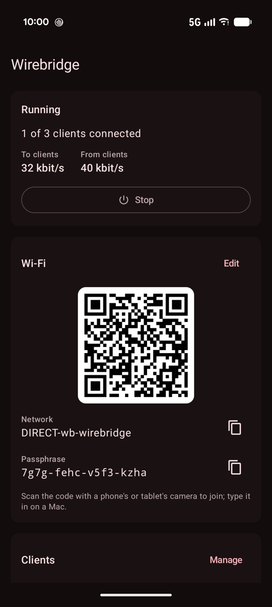
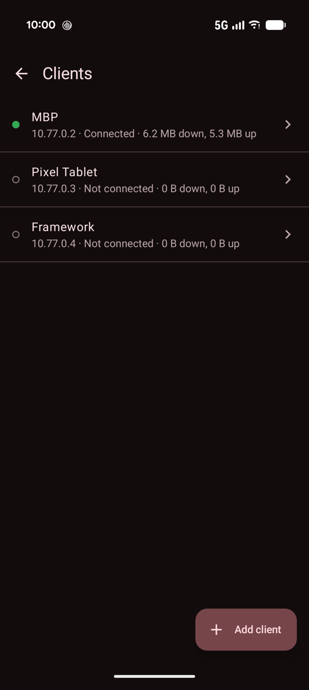

# wirebridge

Shares an Android phone's internet connection with a Mac, a tablet, or any number of other devices at once. Each device
runs the official WireGuard app with a full tunnel to the phone, over a Wi-Fi Direct group the phone makes. An app on
the phone terminates WireGuard in user space and opens every TCP connection and UDP flow from its own sockets.

What it is for:

- the phone's cellular data, where the devices have no network of their own;
- a Wi-Fi that wants a sign-in, as in hotels and on planes: sign in once on the phone, and every device goes through it,
  instead of signing in on each one, where such a network often admits only one device.

<p>
  
  
</p>

[ofutun](https://github.com/hrntknr/ofutun) does the same with Go and gVisor.

## How it works

```
devices  a Mac, a tablet, ...: the official WireGuard apps, each with its own config
  |      WireGuard (UDP) over the phone's Wi-Fi Direct group
  v
phone    the Wirebridge app: a foreground service, started and stopped in the app or from a Quick Settings tile
           the group     DIRECT-wb-<name>, WPA2
           boringtun     one WireGuard session per device
           smoltcp       terminates each device's TCP connections; UDP needs no stack
           tokio         opens each flow to its real destination from the app's own sockets
  |
  v
the phone's network: cellular, or the Wi-Fi it is on
```

- **The group.** Start makes a WPA2 Wi-Fi Direct group named `DIRECT-wb-` and a name set in the app (`wirebridge` until
  changed), with a passphrase typed in or generated there. Android serves it as a local network without internet: a
  device on it reaches the phone and nothing else, except through the tunnel. Stop removes it.
- **Devices.** Each device is a client with its own key pair and its own address in the tunnel (10.77.0.2 to
  10.77.0.254), added and removed in the app. The app makes every key pair. A device's private key leaves the phone only
  in that device's config, so the group's passphrase is what guards the tunnel, as any Wi-Fi's password guards it.
- **Configs.** A device gets its config as a link on the group (`http://<the phone's address>:8080/c/<token>.conf`,
  with a token of its own), as a QR code, or through Android's share sheet. Every config is a full tunnel
  (`AllowedIPs 0.0.0.0/0, ::/0`) with DNS 1.1.1.1, and downloads as `wirebridge.conf`.
- **Nothing is forwarded at the IP layer**, which an app without root cannot do. Each TCP connection a device opens is
  terminated on the phone by a small TCP stack (smoltcp) and opened again from the phone's own socket; each UDP flow
  gets a socket of its own. The phone connects to the real destination first, so a closed port or an unreachable host
  is refused rather than left hanging.

## Requirements

- An Android phone with Wi-Fi Direct, on Android 13 or later. Its Wi-Fi has to be on, since the group needs it, even
  when the phone's own connection is cellular.
- The official WireGuard app on each device.
- To build: Rust with the `aarch64-linux-android` target and [cargo-ndk](https://github.com/bbqsrc/cargo-ndk), the
  Android SDK with NDK 29, and JDK 17 or later (Android Studio's will do).

## Build

```
JAVA_HOME="/Applications/Android Studio.app/Contents/jbr/Contents/Home" \
ANDROID_HOME=~/Library/Android/sdk \
apps/android/gradlew -p apps/android :app:installDebug
```

The Rust core is always built in release, even for a debug APK.

## Using it

On the phone, open Wirebridge, allow "Nearby devices" and notifications, and tap Start. Home shows the Wi-Fi to join,
as a QR code and as a name and passphrase. Under Clients, add one client for each device. To start and stop Wirebridge
without opening it, add its tile from Quick Settings' edit screen.

On a Mac, the first time:

1. Join the Wi-Fi from the Wi-Fi menu, with the passphrase on the phone's screen. The Mac has no internet on it until
   the tunnel is up.
2. Type the client's link, shown on its screen in the app, into Safari: `wirebridge.conf` lands in Downloads.
3. In the WireGuard app: Manage Tunnels, +, Import Tunnel(s) from File, that file; allow the VPN configuration;
   Activate.
4. For the tunnel to come up by itself on the group, edit it and turn on On-Demand for Wi-Fi, only for the group's
   name.

On a phone or a tablet: scan the Wi-Fi's QR code with the camera, then, in the WireGuard app, +, Scan from QR code, and
scan the code on the client's screen.

After that, Start on the phone is all it takes: the devices join the group and their tunnels come up. Stop removes the
group, and each device goes back to whatever network it knows.

**Tailscale on a Mac.** The standalone Tailscale app binds its own connections to the Wi-Fi interface, which on the
group reaches only the phone, so nothing of the tailnet works there. The line below makes it follow the routes into the
tunnel instead. Then Disconnect and Connect in Tailscale's menu: the setting is read only when its extension starts.
Peers are then reached through DERP.

```
echo 'TS_BIND_TO_INTERFACE_BY_ROUTE=true' | sudo tee -a /private/var/root/Library/Containers/io.tailscale.ipn.macsys.network-extension/Data/tailscaled-env.txt
```

## Known limits

- IPv4 only inside the tunnel, and `ping` does not work: ICMP is not forwarded.
- A destination that never answers is refused only after a 10 s connect timeout.
- A config can be made only while Wirebridge runs: its endpoint is the phone's address on the group, read once the
  group is up.
- The group needs the phone's Wi-Fi on, and lasts only as long as the app's process.
- A Mac that has joined the group may pick it over other known Wi-Fi while it is up. Stop Wirebridge when it is not
  needed.
- The speed is the phone's: its cellular link or the Wi-Fi it is on, shared by every device.

## Development

```
cargo test -p wirebridge-core
cargo clippy --workspace --all-targets --features wirebridge-core/bindgen -- -D warnings
```

The tests run WireGuard clients written with boringtun against the server on loopback.

```
crates/core/     the Rust core: WireGuard (wg.rs), the TCP/UDP stack (stack/), the server the app drives through
                 UniFFI (server.rs), a client's config (conf.rs)
apps/android/    the app: the foreground service, the Wi-Fi Direct group, the clients, the screens, the tile
design/          what the icon was chosen from
```

## License

MIT
